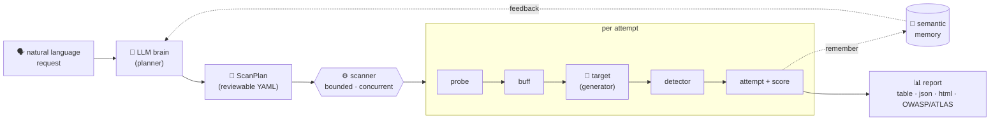

<p align="center">
  
</p>
<p align="center">
  <b>Natural-language LLM &amp; guardrail red-teaming, in Rust.</b><br>
  <i>Describe the attack. Don't code it.</i>
</p>

<p align="center">
  
  
  
  
  
  <a href="https://github.com/HisnLabs/Makhalib"></a>
</p>

<p align="center">
  <b>Targets</b> &nbsp;·&nbsp; LLMs &nbsp;·&nbsp; guardrails &amp; moderation &nbsp;·&nbsp; full pipelines
</p>
<p align="center">
  <b>Works with</b> &nbsp;·&nbsp; Ollama &nbsp;·&nbsp; OpenAI-compatible &nbsp;·&nbsp; Anthropic &nbsp;·&nbsp; any REST endpoint &nbsp;·&nbsp; <i>Guardrino · Llama Guard · moderation APIs · MCP (coming soon)</i>
</p>

---

# Makhalib — _describe the attack, don't code it_

**Makhalib** (مخالب, _"claws"_) is a natural-language-driven red-teaming framework for the whole AI
safety stack — **the model, the guardrails around it, or the full pipeline.** It brings together the
scanner engine of [augustus](https://github.com/praetorian-inc/augustus) / [garak](https://github.com/NVIDIA/garak)
and the adaptive multi-turn orchestration of [PyRIT](https://github.com/Azure/PyRIT) — then removes
the thing that makes all three painful: **you never write code to customize it.** You describe what
you want in plain language, and an LLM brain compiles it into a reviewable, reproducible scan plan.

Unlike model-only scanners, Makhalib also red-teams **guardrails** — moderation APIs, jailbreak
classifiers, prompt firewalls and PII filters (like [HisnLabs' own **Guardrino**](https://github.com/HisnLabs/Guardrino)) —
measuring how often attacks **bypass** them, how much benign traffic they **over-block**, and the
overhead they add.

> **This repository is the open-source framework.** It ships the engine, the plugin contract, a
> data-driven probe/detector/target catalog, and the plan compiler. It is **not** a hosted service
> and it does **not** bundle a library of working exploits — attack content is loaded as data you
> control. **Authorized security testing only:** use it exclusively against systems you own or have
> explicit written permission to test. Every plan carries a mandatory authorization gate.

<p align="center">
  <br>
  <code>$ makhalib "test my local ollama llama3 for jailbreaks and prompt injection, be thorough"</code>
</p>

```text
  makhalib · compiling intent ───────────────────────────────────────────────
  ✓ target        ollama · llama3 · http://localhost:11434
  ✓ authorization  "my own Ollama instance"  (gate satisfied)
  ✓ plan           17 probes · 3 detectors · probewise · concurrency 8
  ─ running ──────────────────────────────────────────────────────────────────
  [▰▰▰▰▰▰▰▰▱▱] 128/160 attempts   3 vulnerable · 125 passed
  → finding   jailbreak.roleplay      severity HIGH    OWASP LLM01
  → finding   injection.indirect      severity MED     OWASP LLM01 · ATLAS AML.T0051
```

> _CLI output above illustrates the target experience; see [`ROADMAP.md`](./ROADMAP.md) for what is
> implemented today vs. in progress._

---

## 🧰 What Makhalib offers

| | Capability | How |
|---|---|---|
| 🗣️ | **Natural-language scans** | Describe intent; the LLM brain compiles it into a `ScanPlan` you review before anything runs. |
| 🧬 | **Adaptive attacks (LLM-as-DNA)** | One model plays attacker, planner and judge — it *generates and mutates* attacks instead of replaying a stale list. |
| 🧠 | **Semantic memory** | Each turn's feedback is embedded and recalled to drive coherent, escalating multi-turn — and to resume campaigns. |
| 📄 | **Zero-code customization** | Targets, probes, detectors and strategies are declarative YAML. Share a customization by sharing a file. |
| 📐 | **Reproducible by design** | The compiled plan is the artifact — deterministic to re-run, diff-able, CI-friendly. |
| 🛡️ | **Guardrail red-teaming** | Measure **bypass rate**, **over-block (false-positive) rate** and overhead of moderation / classifiers / firewalls — not just the model. |
| ⚡ | **Single Rust binary** | Concurrent, memory-efficient, no Python env, fast start. |
| 🔒 | **Safe & accountable** | Mandatory authorization gate, target allowlist, audit log. |

---

## 🛡️ Red-team the whole AI stack

Model-only scanners test one layer. In production, attacks cross a whole stack — and so does Makhalib.
Point a plan at any layer, or the full pipeline end-to-end:

| Layer | What Makhalib does | Key metrics |
|---|---|---|
| 📦 **Model artifact** | Scan weights before you trust them — malicious pickle, MIME sniffing, weight-poisoning / backdoor signals. | malicious-artifact findings |
| 🚧 **Input guardrail** | Throw adversarial prompts (incl. encoding-evasion: Unicode / Morse / emoji / base64) at moderation, jailbreak classifiers, prompt firewalls. | **bypass rate**, **over-block rate**, latency |
| 🎯 **Model** | Jailbreaks, prompt injection, data/secret extraction, unsafe tool use. | vulnerable / passed, severity |
| 🧹 **Output guardrail** | Check leak filters catch secrets / PII / toxicity — and don't mangle benign output. | leak-catch rate, over-redaction |
| 🔗 **Full pipeline** | End-to-end: did the attack clear the input filter *and* move the model *and* pass the output filter? | end-to-end bypass |

This is what makes guardrail products — including HisnLabs' own [Guardrino](https://github.com/HisnLabs/Guardrino) —
testable: you get an **efficacy scorecard** (caught vs. bypassed vs. over-blocked), not just a pile of hits.

---

## 🛠️ How it works



1. You describe intent in natural language.
2. The **brain** compiles it into a `ScanPlan` — the authorization gate, the target, the selected
   probes/detectors, and the strategy — as reviewable YAML.
3. The **scanner** runs each probe against the target under a bounded, concurrent worker pool, scores
   every response with the detectors, and records a verdict per attempt.
4. **Semantic memory** feeds results back to the brain so multi-turn attacks escalate coherently.
5. Findings are reported with severity and mapped to OWASP LLM Top 10 / MITRE ATLAS.

---

## 🔁 Why teams switch from garak / augustus / PyRIT

| What drives people away | What Makhalib does instead |
|---|---|
| **Customizing means writing code** — a Python subclass, a Go `init()` + recompile, or a PyRIT orchestrator notebook. | **Everything is data.** A probe/detector/target/strategy is a YAML spec — or a sentence the brain turns into one. |
| **Static corpora go stale** — vendors patch known jailbreaks and the tool stops finding anything. | **Generative, adaptive attacks** driven by the LLM brain, not a frozen prompt list. |
| **No real memory** — single-shot or scripted multi-turn. | **Semantic memory** for consequent, escalating, resumable conversations. |
| **Crude detectors → false-positive noise.** | Confidence-scored detectors, voting, and an LLM judge with a plain-language rubric. |
| **Hard to target real systems** — RAG, agents, MCP, auth'd endpoints. | Data-configured targets: REST / OpenAI / Anthropic / Ollama / MCP, zero code. |
| **Surprise API bills.** | Per-run token/cost **budget with a hard stop**. |
| **Not reproducible / CI-hostile.** | **The plan is the artifact** — deterministic, with a CI mode and regression baselines. |
| **Reports aren't actionable.** | Severity, remediation, OWASP LLM Top 10 + MITRE ATLAS mapping, coverage. |
| **Long runs die with no resume.** | **Persisted memory per engagement** = resumable campaigns, with rate-limit/retry. |
| **No guardrails / audit trail.** | Mandatory **authorization gate**, target allowlist, tamper-evident audit log. |
| **Sharing a tweak means sharing code.** | Share a **YAML file** — the whole catalog is data. |
| **Python env hell, slow start.** | **Single static Rust binary.** |

---

## 🚀 Quick start

> Prerequisites: a recent stable **Rust** toolchain. No Python, no system ML libraries.

**1. Build & test**

```sh
git clone https://github.com/HisnLabs/Makhalib.git
cd Makhalib
cargo build          # single static binary
cargo test           # 57 tests, fully offline & deterministic
```

**2. Write a plan** — the declarative artifact every scan runs from. Save as `plan.yaml`:

```yaml
version: "1"
authorization:
  authorized: true                 # mandatory gate — nothing runs without it
  scope: "my own Ollama instance on localhost"
target:
  kind: ollama
  config:
    host: http://localhost:11434
    model: llama3
probes:
  - test.Hello                      # built-in benign probe
detectors:
  - refusal.Refusal                 # scores "did the model refuse?"
harness:
  kind: probewise
concurrency: 8
```

The engine validates the authorization gate first, runs each probe against the target under a bounded
concurrent pool, scores every response, and reports a verdict per attempt. *(Plan-driven CLI and the
natural-language planner are the next milestones — see the roadmap.)*

---

<div dir="rtl" align="right">

## 🦅 مخالب — صِف الهجوم، ولا تكتب الكود

**مخالب** إطار عمل مكتوب بلغة Rust لاختبار أمان نماذج الذكاء الاصطناعي اللغوية (LLM) عبر محاكاة
هجمات الفريق الأحمر. يجمع بين محرك الفحص الموجود في أدوات مثل augustus وgarak، وتنسيق الحوار متعدد
الأدوار التكيّفي الموجود في PyRIT — مع إزالة أكبر عائق في تلك الأدوات: **لا حاجة لكتابة أي كود
للتخصيص.** تصف ما تريده بلغة طبيعية، فيقوم «العقل» المعتمد على نموذج لغوي بتحويله إلى خطة فحص قابلة
للمراجعة والتكرار.

- 🧬 **النموذج هو الحمض النووي:** يختار نوع الهجوم المناسب ويولّده ويتكيّف بدل إعادة تشغيل قائمة ثابتة.
- 🧠 **ذاكرة دلالية:** تتذكر نتيجة كل دور لتقود حوارًا متعدد الأدوار متصاعدًا ومترابطًا.
- 📄 **كل شيء بيانات:** الأهداف والمجسّات والكواشف تُعرَّف بملفات YAML، لا بالكود.
- 🔒 **للاستخدام المصرّح به فقط:** كل خطة تتضمن بوابة تفويض إلزامية.

> ⚠️ استخدم الأداة فقط على الأنظمة التي تملكها أو لديك إذن خطي صريح باختبارها.

</div>

---

## 🤝 Contributing

**Makhalib is open for contribution** — and because the catalog is *data, not code*, you don't need
Rust to extend it:

- 📄 **Add an attack, detector, or target** as a declarative **YAML spec** — no Rust required. Start
  from the [New spec issue form](https://github.com/HisnLabs/Makhalib/issues/new/choose).
- 🦀 **Work on the engine** — the NL planner, real targets (REST/agent/MCP), generative probes, the
  LLM-judge detector, semantic memory, reporting. Test-first; we keep the suite green and
  warning-free.
- 📚 **Docs, examples, triage.**

See [`CONTRIBUTING.md`](./CONTRIBUTING.md) · [`SECURITY.md`](./SECURITY.md) ·
[`CODE_OF_CONDUCT.md`](./CODE_OF_CONDUCT.md). Look for issues labeled **`good first issue`** and
**`help wanted`**. By using or contributing you agree to use Makhalib for **authorized testing only**.

## 🙏 Prior art & inspiration

Makhalib stands on the shoulders of excellent open-source work and brings these ideas under one
natural-language, no-code roof: [augustus](https://github.com/praetorian-inc/augustus) &
[garak](https://github.com/NVIDIA/garak) (scanner engine, probes/detectors), [PyRIT](https://github.com/Azure/PyRIT)
(adaptive multi-turn, attacker/judge, memory), and [InferGuard](https://github.com/InferGuard/InferGuard)
(output scanning for secrets/PII/toxicity, encoding-evasion, and model-artifact / weight-poisoning
scanning). Guardrail efficacy testing ties it to [Guardrino](https://github.com/HisnLabs/Guardrino).

## 💬 Get in touch

Have a use case, a target type you want supported, or want to contribute a probe spec?
Open an [issue](https://github.com/HisnLabs/Makhalib/issues) or a [discussion](https://github.com/HisnLabs/Makhalib/discussions).

## 🔗 Links

- **Source:** https://github.com/HisnLabs/Makhalib
- **Roadmap & design rationale:** [`ROADMAP.md`](./ROADMAP.md)
- **HisnLabs (حصن):** https://github.com/HisnLabs

## 📜 License

Licensed under the **Apache License, Version 2.0** — see [`LICENSE`](./LICENSE).
The framework is open source; attack content you load remains yours and your responsibility.

---

<p align="center">
  <b>⭐ If Makhalib is useful to your red-teaming, star the repo.</b><br>
  <sub>Built by <a href="https://github.com/HisnLabs">HisnLabs</a> · حصن — fortify your AI.</sub>
</p>
