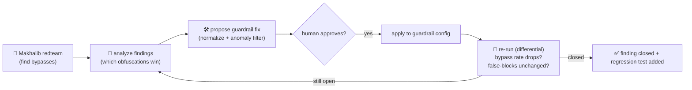

# Makhalib Defender — Skills + MCP + Agent (spec)

Makhalib finds how a guardrail is bypassed. The **Defender** closes the loop: it turns findings into a
concrete guardrail fix, applies it, and **re-tests to prove the bypass is gone** — without raising
false-blocks. Delivered as three composable surfaces so a defender can wire it into their own pipeline
with no glue code.

> Status: **spec** (P16). The red-team engine it builds on is shipped (V0.0.1). Authorized use only.

## The loop

This is **differential testing** (MET-03): measure bypass rate *with* and *without* the fix, and
false-block rate on a benign set, so safety isn't bought with over-refusal (release-gate check #7).

## Surface 1 — Claude Skill: `makhalib-harden`

A packaged skill a defender's Claude loads to read a Makhalib run and harden the guardrail. It encodes
the playbook, e.g. for the **character/encoding bypasses we confirmed against Guardrino** (rot13,
reverse, leetspeak):

- **Normalize-then-classify.** Score the input across multiple normalized views and flag if *any*
  view trips: original, Unicode NFKC + confusable-fold (homoglyphs), de-leetspeak, strip zero-width /
  bidi / variation-selectors, de-whitespace, and known reversible transforms (base64/rot13/reverse).
- **Obfuscation anomaly filter** (per [Broken-Token](https://arxiv.org/pdf/2510.26847)): flag inputs
  whose **chars-per-token** or non-dictionary-character ratio is abnormal — catches encodings the
  normalizer doesn't enumerate.
- **Add the finding to the regression set** so it can never silently come back.

The skill outputs a config diff + a one-line rationale per change; it never deploys on its own.

## Surface 2 — MCP server: `makhalib-mcp`

Exposes Makhalib as MCP tools so any agent/IDE/CI runs it with no bespoke integration:

| Tool | Purpose |
|---|---|
| `redteam_guardrail(endpoint, scope, max_depth, token_limit)` | run the adaptive bypass test; returns a run id + summary |
| `get_findings(run_id)` | the confirmed bypasses (category, mutations, severity) |
| `verify_fix(endpoint, baseline_run_id)` | re-run and diff vs baseline (bypass rate ↓, false-block ↓?) |
| `list_buffs()` / `list_seeds()` | catalog introspection |

Server-side it enforces the authorization gate and the token budget; results stay local to the caller.

## Surface 3 — Defender agent

An autonomous loop over the two surfaces above: `redteam` → analyze → (skill) propose fix → **human
approval** → apply to the guardrail config → `verify_fix` → on success, commit the regression test;
on failure, iterate. It reports a short before/after: *"rot13/reverse/leetspeak bypass 47.8% → 0%,
false-block rate unchanged; regression tests added."* The human owns the apply/deploy step; the agent
never accepts its own residual risk (framework GOV-04).

## Why three surfaces

- The **Skill** carries the expertise (how to harden) and runs inside the defender's own Claude.
- The **MCP server** makes the engine callable from anywhere (CI, IDE, another agent).
- The **agent** orchestrates them into a hands-off loop a human only has to approve.

## Build order (P16)

1. MCP server wrapping the shipped `redteam` + `verify_fix` (differential) tools.
2. `makhalib-harden` skill with the normalize + anomaly-filter playbook.
3. Defender agent tying them together, approval-gated.
